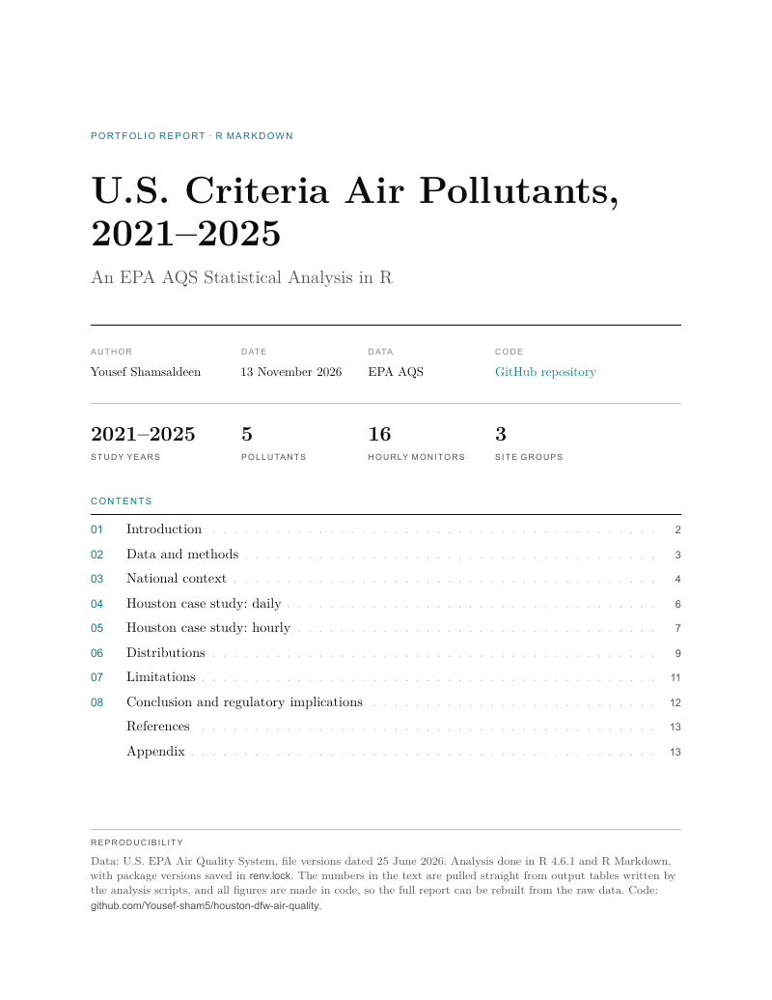

# U.S. Criteria Air Pollutants, 2021–2025: An EPA AQS Statistical Analysis in R

This project uses R to clean, explore and model five years of EPA Air Quality System (AQS) data for PM2.5, ozone, NO₂, SO₂ and CO. The national daily data hold 8.9 million records, 5.56 million after cleaning. The case study adds hourly pollutant and weather data for 16 monitors in Houston and Dallas–Fort Worth (661,545 monitor-hours).

**Status:** Complete. Phases 1 to 3 hold the analysis, and the 29-page report (`R/houston_dfw_air_quality.Rmd`, knit to `houston_dfw_air_quality.pdf`) presents it. Five years is too short to separate a trend from year-to-year weather, so the project does not test trends. 43 figures.

<a href="houston_dfw_air_quality.pdf">
  
</a>

**[Read the full report (PDF, 29 pages)](houston_dfw_air_quality.pdf)**

## Research question

How do pollutant levels and NAAQS compliance near the Houston Ship Channel, lined with refineries and chemical plants in east Harris County, compare with the rest of Harris County and with Dallas–Fort Worth (Dallas and Tarrant counties)? Ship Channel sites are Harris County monitors within 7.5 km of the channel. Comparing within Houston keeps the weather about the same, and Dallas–Fort Worth helps separate an industrial signal from general city pollution.

## Methods at a glance

| Phase | Techniques | Status |
|---|---|---|
| 1. Import and cleaning | Daily data for 5 pollutants nationwide, and hourly pollutants and weather for 16 monitors at 9 sites. Row counts checked against EPA's; unusual readings flagged and kept | Done |
| 2. Exploratory analysis | National NAAQS screening, events, seasons and weekends; same-day group differences, daily cycles, an Ox (ozone + NO₂) test, SO₂ spikes, calm air and pollution roses, with block-bootstrap ranges and every result rerun under every check | Done |
| 3. Distributions | Lognormal, gamma and Weibull curves fitted per site and ranked by AIC, tail tests against the actual days, and one ozone design value checked against EPA's file | Done |
| 4. Report | R Markdown PDF. Every number is read from the saved headline tables, and the knit stops if one is missing | Done |

## Data quality highlights

- Cleaning cut 8,930,992 raw rows to 5,557,574; most of the 37.8% removed were repeat summaries of the same monitor and day.
- Methods are checked against EPA's FRM/FEM table, and 313,057 raw T640/T640X PM2.5 rows were replaced by EPA's corrected versions.
- 22 sourced events are labelled under one rule a script rechecks, and named assertions, a data dictionary and checkpoint MD5s guard each step.
- The hourly data rebuild all 27,747 daily maximums exactly. A site move, a method change and five sensor replacements are checked against neighbours and flagged.

## Findings (Phase 2, national)

- **NAAQS screening:** in 2023, 42.7% of five-year ozone sites and 39.0% of annual PM2.5 sites were above the standard; with three-year windows, about 23% of ozone sites.
- **Events:** smoke, dust and storm days hold 39.9% of PM2.5 exceedance days (68.2% in 2023), and EPA's own event flag covers only 14% of them.
- **Weekends:** NO₂ is 20% lower at the median site. Weekend ozone rises in Los Angeles (+5.0%), consistent with VOC-limited ozone, and falls in Houston (−4.0%) and Dallas–Fort Worth (−4.8%).
- **Houston and Dallas–Fort Worth** rank 6th and 8th of 353 metros with an ozone exceedance, by exceedance site-days.

## Findings (Phase 2, case study)

Groups are compared on the same day or hour, with 95% block-bootstrap ranges, and rerun under every check that changes them. Each hourly group has two ozone and NO₂ sites.

- **NO₂:** the Ship Channel is 1.15 ppb above Houston other (0.81 to 1.41) in every year, at all 24 hours and under every check, consistent with nearby NOx sources.
- **Ozone:** the Ship Channel is 0.97 ppb below Houston other, and Houston is 4.0 ppb below Dallas–Fort Worth. SO₂ and PM2.5 show no useful gap.
- **Why ozone is lower (Ox):** adding NO₂ back to ozone closes 52% of the Ship Channel's ozone gap, or 99% without Harvard Street (the Houston other site nearest the channel), consistent with fresh NO using up ozone. The rest shows up in wind from the channel.
- **SO₂ spikes (an hour at 5 ppb or more):** spikes last about an hour and rarely hit two sites at once, consistent with local plumes. Croquet's come by day from the southwest, away from the channel; Park Place's come from the channel side.
- **Calm air:** Houston is calm 4 to 6 times as often as Dallas–Fort Worth, and calm hours have 3.0 to 6.8 ppb more NO₂ and 3.8 to 9.0 ppb less ozone on average than windy hours at the same site, hour and month.
- **Checks:** all ten main hourly findings hold under every check that applies and with a second random seed (figure 2C.12).

## Findings (Phase 3, distributions)

Curves are fitted per site on ordinary days at 2,425 five-year sites. Design values use every day at the 22 case-study ozone sites.

- **Which curve:** a lognormal fits best at most SO₂ (188 of 249) and CO (82 of 132) sites, and a normal curve would win at 525 of 964 ozone sites if allowed. Neighbouring days are linked, so AIC gaps overstate certainty: only 52% of tested ozone sites keep their winner when resampled.
- **PM2.5 monitors:** at the same 67 sites, a lognormal wins 96% of fits on T640 monitors and 46% on others, consistent with an instrument effect.
- **Ozone spread:** in warm months, ozone varies more from day to day in Houston than in Dallas–Fort Worth (spread factor 1.47 and 1.46 against 1.34), and the Ship Channel matches Houston other.
- **Deer Park #2 SO₂:** the lognormal's win depends on days below the detection limit. Counting those only as "below the limit" moves the win to a Weibull curve that gets the number of high days about right.
- **Tails:** the best-fit curve lands within 25% of the actual top 1% of days at only 23% to 32% of sites, and a lognormal would about double ozone exceedance counts.
- **Ozone design values:** Houston Aldine's 2023–2025 value is (0.078 + 0.097 + 0.073) / 3, truncated to 0.082 ppm, matching EPA's file. All 22 case-study ozone sites are above the 0.070 ppm standard, and the method matches EPA at 61 of 66 site-windows (each miss 0.001 ppm low).
- **Checks:** all 88 pairs of 12 figure findings and their checks hold (figure 3.10), and all 20 validation checks pass.

## Conclusions

- **H1, more NO₂ near the channel: supported.** Higher in every year, on the same days and at all 24 hours, under every check.
- **H2, less ozone because fresh NO uses it up: supported in part.** Ox closes 52% of the ozone gap, or 99% without Harvard Street; the rest shows up in wind from the channel, consistent with ozone forming downwind.
- **H3, SO₂ from short local plumes: supported.** One-hour spikes over a background below the detection limit, from more than one direction.
- **Lower ozone near the channel does not mean cleaner air:** every case-study ozone site, including the Ship Channel sites, is above the 0.070 ppm standard for 2023–2025.

## Engineering angle

Gas readings are converted to µg/m³ with the ideal gas law (RT/P = 24.465 L/mol at 25 °C and 1 atm). The Ox test is built on the NO + O₃ → NO₂ + O₂ balance.

## Tech stack

R (`dplyr`, `tidyr`, `readr`, `readxl`, `lubridate`, `ggplot2`, `patchwork`, `fitdistrplus`, `moments`, `kableExtra`), R Markdown with LuaLaTeX (TinyTeX), Git and GitHub.

## Reproduce

Data come from the [EPA AirData download page](https://aqs.epa.gov/aqsweb/airdata/download_files.html) (public domain; file versions dated 2026-06-25).

1. **Daily Data:** the 2021–2025 zips for 88101 (PM2.5), 44201 (ozone), 42602 (NO₂), 42401 (SO₂) and 42101 (CO), unzipped into `data/raw/daily/`.
2. **Hourly Data:** the 2021–2025 Criteria Gases zips for 44201, 42602 and 42401 into `data/raw/hourly/`, and the Meteorological `hourly_WIND` and `hourly_TEMP` zips into `data/raw/weather/`. Leave both zipped.
3. Open `EPA AQS Project.Rproj`, run `R/0_setup.R` once and restart R. `renv::restore()` gives the exact package versions (R 4.6.1).
4. Source the scripts in order: `1a`, `1b`, `1c`, `1d`, `1e`, `2a`, `2b`, `2c`, `3_distributions`. First runs of `1d`, `1e` and `3_distributions` are slow (up to about 45 minutes for `3_distributions`); later runs reuse saved results.
5. Knit `R/houston_dfw_air_quality.Rmd` in RStudio. The PDF lands in the project root in under a minute.

The figures use Arial, so RStudio's Plots pane needs its Graphics Backend set to AGG. Spread across sites or days is drawn as box plots: box = middle half, line = median, whiskers = 10th to 90th percentile.

## Repository structure

<details>
<summary>Show folder layout</summary>

```text
EPA AQS Project/
├── data/
│   ├── raw/                # not tracked
│   ├── hourly_filtered/    # not tracked: cached case-study rows
│   ├── weather_filtered/   # not tracked: cached case-study rows
│   ├── distribution_cache/ # not tracked: saved slow steps
│   ├── reference/          # method table, events, channel shape, site groups, EPA ozone design values
│   └── processed/          # checkpoints (.rds), data dictionary and manifest
│       ├── phase1/         # CSV records
│       ├── phase2/         # CSV records
│       └── phase3/         # CSV records
├── R/                      # scripts, run in order, utils.R and the report source
├── figures/                # numbered, one folder per phase
│   ├── phase1/             # case-study site maps, wide and narrow
│   ├── phase2/             # 2a.01_ to 2a.10_, 2b.01_ to 2b.09_, 2c.01_ to 2c.13_
│   └── phase3/             # 3.01_ to 3.10_
├── fonts/                  # report fonts and their licences
├── docs/                   # methodology.md, report_cover.png
├── houston_dfw_air_quality.pdf  # the report
├── renv.lock               # package versions used
└── README.md
```

</details>

## Limitations

- **Changing network:** from 2021 to 2025, PM2.5 rows grew 23.6% and SO₂ and CO rows fell about 18%, so levels use five-year sites only.
- **Screening values:** every year is checked against today's standards, including the 9.0 µg/m³ annual PM2.5 level set in 2024. Three-year design values are worked out only for the 22 case-study ozone sites.
- **Weather and placement:** seasonal and weekend comparisons do not control for weather, and monitors are not placed at random.
- **Site groups:** distance to the channel stands in for distance to the plants along it, and wind direction alone does not prove a source.
- **Small hourly groups:** two ozone and NO₂ sites per group, so the hourly results describe those sites.
- **No NO or NOx data:** Ox shows how much of the ozone gap titration explains, but the rest cannot be split into local and regional parts.
- **Many comparisons:** dozens of ranges are reported with no multiple-comparison correction, so the results that hold under every check are the safest to cite.

## Author

Yousef Shamsaldeen | [LinkedIn](https://www.linkedin.com/in/yshamsaldeen/)
